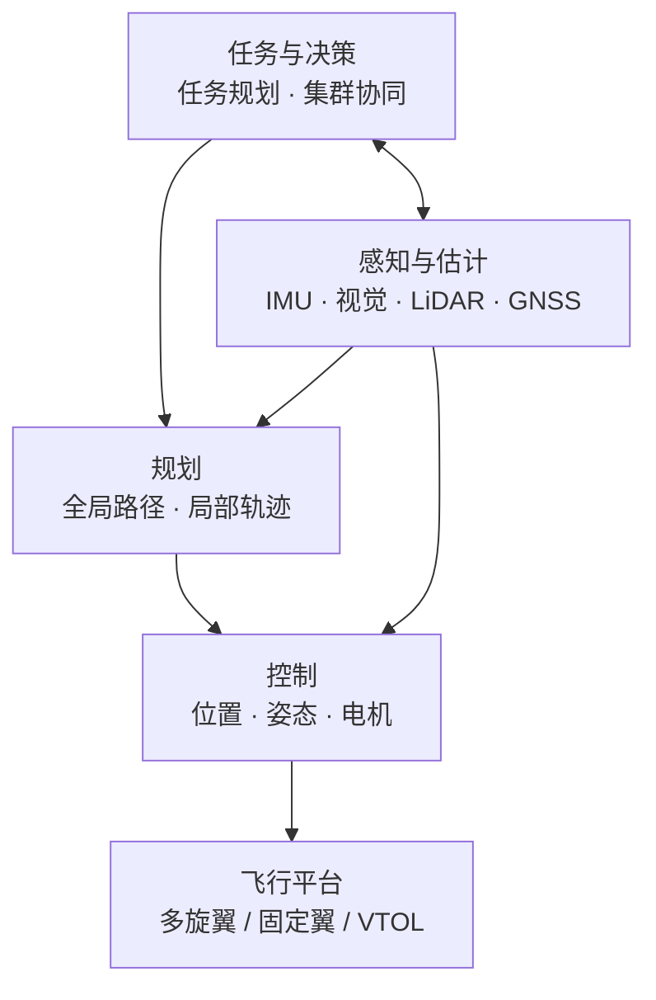

# 无人机 / 飞行机器人 / 集群控制

> UAV · Aerial Robotics · Swarm Control — 研究与实现

本仓库围绕**无人机**（UAV）、**飞行机器人**（Aerial Robotics）与**集群控制**（Swarm Control）三个相互关联的方向，整理基础理论、关键技术、学习路线与工程资源，并逐步沉淀可复现的实现与实验。

适合刚进入该方向的学生、工程师，以及需要快速建立技术版图的研究者阅读。

> 仓库目前处于起步阶段：本 README 作为方向导览，后续内容将按[仓库规划](#仓库规划)逐步补充。

## 目录

- [项目简介](#项目简介)
- [方向概览](#方向概览)
- [核心研究内容](#核心研究内容)
- [技术栈](#技术栈)
- [学习路径](#学习路径)
- [快速开始](#快速开始)
- [常见问题](#常见问题)
- [推荐资源](#推荐资源)
- [仓库规划](#仓库规划)
- [参与贡献](#参与贡献)

## 项目简介

无人机与飞行机器人是机器人学、控制理论、状态估计、人工智能与通信技术的交叉方向。相比地面机器人，飞行平台具有三维机动能力和广阔视野，但也受到载荷、续航、安全性与动力学约束的严格限制。

从研究层次看，本方向大致可以分为三层：

- **无人机（UAV）**：以多旋翼、固定翼、垂直起降（VTOL）等飞行器为平台，解决稳定飞行、导航定位与自主任务执行等问题。
- **飞行机器人（Aerial Robot）**：在飞行平台基础上强调与环境或其他对象的物理交互，例如空中抓取、接触式巡检、栖息与空中作业。
- **集群控制（Swarm Control）**：研究多架飞行器在通信、计算与感知受限条件下的协同，包括编队保持、任务分配、覆盖搜索与协同运输等。

三者共享底层的动力学、控制与估计理论，但关注点不同：单机追求**稳定与自主**，飞行机器人追求**交互能力**，集群追求**协同与可扩展性**。

## 方向概览

| 层次 | 核心问题 | 典型任务 |
| --- | --- | --- |
| 飞行平台 | 如何稳定地飞起来 | 姿态控制、位置控制、悬停、轨迹跟踪 |
| 单机自主 | 如何在未知环境中完成任务 | 定位与建图、避障、自主探索、返航 |
| 飞行机器人 | 如何与环境发生物理交互 | 空中抓取、接触作业、栖息、协同搬运 |
| 集群系统 | 多机如何高效协同 | 编队保持、覆盖搜索、围捕、协同运输 |

一个典型的自主飞行系统通常按「任务—规划—控制—平台」分层，感知与估计为规划和控制提供状态反馈：



### 术语速查

| 缩写 | 含义 |
| --- | --- |
| UAV / MAV | 无人机 / 微型飞行器 |
| VTOL | 垂直起降 |
| VIO | 视觉惯性里程计 |
| SLAM | 同步定位与建图 |
| MPC | 模型预测控制 |
| SITL / HIL | 软件在环 / 硬件在环仿真 |
| GNSS | 全球导航卫星系统（GPS、北斗等） |

## 核心研究内容

### 飞行平台与动力学

- **平台类型**：多旋翼（四旋翼、六旋翼、八旋翼）、固定翼、垂直起降（VTOL）、扑翼与仿生飞行器。
- **建模**：刚体六自由度动力学、旋翼推力与反扭矩模型、气动阻力与地面效应；常用 SE(3) 描述位姿。
- **参数辨识**：电机—螺旋桨推力曲线、电池压降、执行器延迟与安装误差。
- **设计权衡**：载荷、续航、机动性与安全性之间的平衡。

### 状态估计与感知

- **传感器**：IMU（惯性测量单元）、GNSS/RTK、磁力计、气压计、单目/双目相机、事件相机、LiDAR、UWB（超宽带）。
- **融合方法**：扩展/无迹卡尔曼滤波、因子图优化、MSCKF（多状态约束卡尔曼滤波）；视觉惯性里程计（VIO）与 SLAM。
- **关键问题**：GNSS 拒止、快速机动、弱纹理与光照变化、动态障碍、传感器时空标定。
- **输出**：位姿、速度、地图与障碍物表示，为规划与控制提供状态反馈。

### 运动规划与自主导航

- **全局规划**：`A*`、Dijkstra、RRT、`RRT*`、PRM（概率路线图），以及基于栅格、拓扑和采样的方法。
- **局部规划与轨迹生成**：minimum snap/jerk 多项式、B 样条、模型预测控制（MPC）、人工势场、VFH（向量场直方图）。
- **约束**：动力学可行性、安全距离、传感器视场、能耗与时间最优。
- **自主探索**：前沿法、信息增益、主动感知与在线重规划。

### 飞行控制

- **经典方法**：串级 PID（位置—速度—姿态—角速率）、LQR。
- **先进方法**：几何控制（SE(3)）、反步、滑模、H∞、MPC、增量非线性动态逆（INDI）。
- **工程问题**：风扰与负载变化、执行器饱和、时延补偿、故障容错。
- **飞控软件**：PX4、ArduPilot 的控制器结构与调参实践。

### 集群协同控制

- **编队控制**：领航—跟随、虚拟结构、基于图论/一致性、基于行为。
- **任务分配与调度**：拍卖算法、CBBA（一致性包算法）、匈牙利算法、分布式优化。
- **协同任务**：覆盖搜索、围捕、协同运输、协同巡检。
- **约束与挑战**：通信时延、丢包与拓扑变化，有限感知，可扩展性，碰撞避免与死锁。
- **安全与鲁棒性**：单点失效、队形重构、地理围栏与大规模测试。

### 通信与组网

- **链路**：Wi-Fi、数传电台、4G/5G、Mesh、UWB。
- **协议与中间件**：MAVLink、DDS/ROS 2、自定义协议。
- **关键问题**：带宽、时延、时间同步，以及链路中断下的自主决策。

### 仿真、实验与安全

- **软件在环与硬件在环**：PX4 SITL、Gazebo/gz-sim、RotorS、Flightmare。
- **实机平台**：Crazyflie、PX4 套件、DJI Tello；室内动捕或 UWB 定位。
- **安全规范**：螺旋桨护罩、安全绳、隔离测试区、失效保护与地理围栏；遵守当地空域管理、实名登记与飞行限制要求。

### 可选研究课题

- GNSS 拒止环境下的多传感器融合定位与路径规划；
- 动态障碍环境中的实时局部规划与轨迹重规划；
- 通信受限条件下的集群编队保持与拓扑优化；
- 面向区域覆盖与目标搜索的多机任务分配；
- 空中接触作业的力控制与稳定抓取。

## 技术栈

| 类别 | 常用工具 |
| --- | --- |
| 飞控 | PX4、ArduPilot |
| 中间件 | ROS 2、MAVROS、MAVSDK、MAVLink |
| 仿真 | Gazebo/gz-sim、RotorS、Flightmare |
| 规划与优化 | OMPL、CasADi、OSQP、mav_trajectory_generation |
| 估计与 SLAM | VINS-Mono/Fusion、ORB-SLAM3、OpenVINS |
| 地面站 | QGroundControl |
| 开发语言 | C++、Python、MATLAB/Simulink |

入门推荐组合：**PX4 SITL + Gazebo + ROS 2 + MAVROS**。偏感知可加 VINS 或 ORB-SLAM3；偏集群可从 Crazyswarm2 或 MRS UAV System 起步。

## 学习路径

建议遵循「先仿真后实机、先单机后集群」的顺序：

| 阶段 | 目标 | 主要内容 | 阶段产出 |
| --- | --- | --- | --- |
| 0 · 基础 | 补齐数学与编程 | 线性代数、概率统计、常微分方程、经典控制、C++/Python | 能读懂控制与估计教材 |
| 1 · 起飞 | 理解飞控闭环 | PX4/ArduPilot + SITL；传感器校准；姿态/位置串级控制 | 仿真中完成悬停与轨迹跟踪 |
| 2 · 自主 | 打通感知—规划—控制 | ROS 2、MAVROS、VIO/SLAM、`A*` / `RRT*`、轨迹优化 | 仿真中完成避障与自主导航 |
| 3 · 研究 | 进入具体问题 | 复现一篇论文，搭建自己的实验基线 | 可复现的实验与对比结果 |
| 4 · 集群 | 从单机走向多机 | 多机仿真、通信拓扑、编队与任务分配 | 小规模集群仿真或实机演示 |

## 快速开始

本仓库当前以文档为主，建议按以下顺序动手：

1. **建立技术地图**：先读[方向概览](#方向概览)与[核心研究内容](#核心研究内容)，了解各模块之间的关系；
2. **跑通仿真闭环**：按 [PX4 仿真文档](https://docs.px4.io/main/en/simulation/) 搭建 SITL + Gazebo，完成悬停与轨迹跟踪；
3. **接入机载算法**：用 [ROS 2](https://docs.ros.org/) 与 MAVROS 接入估计、规划和控制节点；
4. **复现最小实验**：从[推荐资源](#推荐资源)中选一篇论文或一个开源项目，复现其核心结果。

> 建议先仿真后实机；实机测试前请阅读[仿真、实验与安全](#仿真实验与安全)中的安全规范。

## 常见问题

**没有飞行硬件可以入门吗？**

可以。PX4 SITL + Gazebo 足以完成姿态控制、位置控制、轨迹跟踪、避障与多机仿真的大部分实验；实机主要用于验证传感器噪声、通信时延与安全策略。

**需要哪些数学基础？**

线性代数、概率统计、常微分方程与经典控制是基础；做规划与控制研究时，还需要最优化、凸优化与最优控制的知识。

**先学 ROS 还是先学飞控？**

建议先理解飞控的姿态/位置闭环与传感器校准，再学习 ROS 2、MAVROS 与机载算法，否则容易把飞控问题误判为框架问题。

**集群实验最少需要几架？**

仿真不受数量限制；实机验证编队、通信与任务分配时，2–3 架即可暴露大部分问题，再逐步扩展规模。

## 推荐资源

### 教材与综述

- Beard & McLain, *Small Unmanned Aircraft: Theory and Practice*, Princeton University Press, 2012.
- Mahony, Kumar & Corke, "Multirotor Aerial Vehicles: Modeling, Estimation, and Control of Quadrotor," *IEEE Robotics & Automation Magazine*, 2012.
- 全权,《多旋翼飞行器设计与控制》, 电子工业出版社, 2017.
- Valavanis & Vachtsevanos (eds.), *Handbook of Unmanned Aerial Vehicles*, Springer, 2015.
- Ollero & Siciliano (eds.), *Aerial Robotic Manipulation*, Springer, 2019.
- Thrun, Burgard & Fox, *Probabilistic Robotics*, MIT Press, 2005.
- LaValle, *Planning Algorithms*, Cambridge University Press, 2006.

### 经典论文

- Lee, Leok & McClamroch, "Geometric Tracking Control of a Quadrotor UAV on SE(3)," *CDC*, 2010.
- Mellinger & Kumar, "Minimum Snap Trajectory Generation and Control for Quadrotors," *ICRA*, 2011.
- Mueller, Hehn & D'Andrea, "A Computationally Efficient Motion Primitive for Quadrocopter Trajectory Generation," *IEEE T-RO*, 2015.
- Karaman & Frazzoli, "Sampling-based Algorithms for Optimal Motion Planning," *IJRR*, 2011.
- Qin, Li & Shen, "VINS-Mono: A Robust and Versatile Monocular Visual-Inertial State Estimator," *IEEE T-RO*, 2018.
- Campos et al., "ORB-SLAM3: An Accurate Open-Source Library for Visual, Visual-Inertial, and Multi-Map SLAM," *IEEE T-RO*, 2021.
- Olfati-Saber, Fax & Murray, "Consensus and Cooperation in Networked Multi-Agent Systems," *Proceedings of the IEEE*, 2007.
- Brambilla et al., "Swarm Robotics: A Review from the Swarm Engineering Perspective," *Swarm Intelligence*, 2013.
- Preiss et al., "Crazyswarm: A Large Nano-Quadcopter Swarm," *ICRA*, 2017.
- Zhou et al., "EGO-Planner: An ESDF-Free Gradient-Based Local Planner for Quadrotors," *IEEE RA-L*, 2021.
- Floreano & Wood, "Science, Technology and the Future of Small Autonomous Drones," *Nature*, 2015.

### 课程

- Coursera：Robotics: Aerial Robotics（宾夕法尼亚大学，Vijay Kumar 主讲）
- [MIT 16.485: Visual Navigation for Autonomous Vehicles](https://vnav.mit.edu/)
- [MIT 6.832: Underactuated Robotics](https://underactuated.mit.edu/)
- [ETH Zurich: Robot Dynamics](https://rsl.ethz.ch/education-students/lectures/robotdynamics.html)（公开课）

### 开源项目

| 项目 | 说明 |
| --- | --- |
| [PX4 Autopilot](https://github.com/PX4/PX4-Autopilot) | 开源飞控栈，支持 SITL 仿真 |
| [ArduPilot](https://github.com/ArduPilot/ardupilot) | 开源飞控与自动驾驶系统 |
| [ROS 2](https://docs.ros.org/) | 机器人中间件与工具链 |
| [MAVROS](https://github.com/mavlink/mavros) | 连接 ROS 与 MAVLink 飞控 |
| [MAVSDK](https://mavsdk.mavlink.io/) | 面向应用的 MAVLink SDK |
| [QGroundControl](https://github.com/mavlink/qgroundcontrol) | 地面站与任务规划 |
| [Gazebo](https://gazebosim.org/) | 机器人仿真器 |
| [RotorS](https://github.com/ethz-asl/rotors_simulator) | 多旋翼仿真 |
| [Flightmare](https://github.com/uzh-rpg/flightmare) | 基于渲染的四旋翼仿真器 |
| [Crazyswarm2](https://github.com/IMRCLab/crazyswarm2) | Crazyflie 集群实验平台（ROS 2） |
| [MRS UAV System](https://github.com/ctu-mrs/mrs_uav_system) | 模块化多旋翼系统栈 |
| [EGO-Planner](https://github.com/ZJU-FAST-Lab/ego-planner) | 四旋翼局部规划与轨迹优化 |
| [Fast-Planner](https://github.com/HKUST-Aerial-Robotics/Fast-Planner) | 快速四旋翼运动规划 |
| [mav_trajectory_generation](https://github.com/ethz-asl/mav_trajectory_generation) | 多项式轨迹生成 |
| [VINS-Mono](https://github.com/HKUST-Aerial-Robotics/VINS-Mono) | 视觉惯性里程计 |
| [VINS-Fusion](https://github.com/HKUST-Aerial-Robotics/VINS-Fusion) | 多传感器视觉惯性融合 |
| [ORB-SLAM3](https://github.com/UZ-SLAMLab/ORB_SLAM3) | 视觉/视觉惯性 SLAM |
| [OpenVINS](https://github.com/rpng/open_vins) | 开源视觉惯性估计器 |
| [OMPL](https://ompl.kavrakilab.org/) | 基于采样的运动规划库 |

### 数据集

- [EuRoC MAV](https://projects.asl.ethz.ch/datasets/doku.php?id=kmavvisualinertialdatasets)：室内视觉惯性数据集，常用于 VIO/SLAM 评测。
- [TUM VI](https://vision.in.tum.de/data/datasets/visual-inertial-dataset)：视觉惯性数据集，包含多种运动与光照条件。
- [UZH-FPV](https://rpg.ifi.uzh.ch/uzh-fpv.html)：面向高速无人机飞行的视觉惯性数据集。

## 仓库规划

本仓库计划按以下结构组织内容，目前尚未全部建立：

```text
docs/          # 方向笔记、术语表、论文阅读记录
algorithms/    # 控制、规划、集群算法的最小实现
sim/           # 仿真环境与场景配置
experiments/   # 实验脚本、配置与结果
references/    # 文献与资源索引
```

后续将优先补充：

1. 各研究方向的概念笔记与论文清单；
2. 基于 PX4 SITL 与 ROS 2 的单机仿真示例；
3. 编队、任务分配等集群算法的最小可运行实现；
4. 实验记录与复现说明。

## 参与贡献

- 通过 Issue 提出资料补充、方向建议或问题讨论。
- 提交 PR 时保持单一主题，说明动机、改动内容与验证方式。
- 文档使用中文，术语首次出现时给出英文；代码遵循所在语言的通用风格。
- 新增外部资源时请确认链接有效，并注明来源。

欢迎交流与指正。
